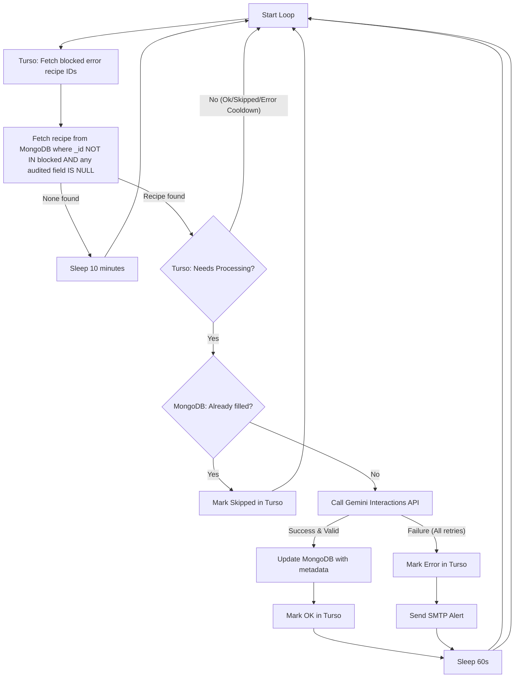

# Tagatoni System Architecture & Design

This document details the system design, purpose, architectural decisions, and error-handling strategies of the **Tagatoni** recipe audit agent.

---

## 1. Purpose

Tagatoni is a background daemon designed to automatically audit recipes posted in the Jorbites ecosystem. Using AI, it populates missing metadata required for SEO optimization and a better consumer user experience:
- **Calories**: An estimated count of calories (`kcal`) per serving.
- **Recipe Cuisine**: Classification of cuisine origin (e.g., Italian, Spanish, Mexican, Mediterranean).
- **Recipe Yield**: Estimates the yield/servings of the recipe (e.g. `4`).
- **Difficulty**: Strict 3-tier culinary complexity classification (`Easy`, `Medium`, `Hard`).
- **Nutritional Information (per serving)**: `protein` (g), `carbohydrates` (g), `fat` (g), `saturatedFat` (g), `fiber` (g), `sugar` (g), and `sodium` (mg).
- **Dietary Tags**: Multi-label canonical dietary classification (`vegan`, `vegetarian`, `gluten-free`, `dairy-free`, `nut-free`, `egg-free`, `soy-free`, `sugar-free`, `low-carb`, `high-protein`, `low-fat`, `keto`, `paleo`).
- **Gantt Table**: A visual cooking-flow matrix organizing ingredients as rows and cooking actions as column spans.

---

## 2. Architecture & Data Flow

Tagatoni runs as an always-on background process, interacting with MongoDB, Turso, the Gemini Interactions API, and SMTP servers.

### High-Level Flow Diagram



---

## 3. Database Integrations

### MongoDB (Core Data Store)
Tagatoni reads recipes directly from Jorbites' primary MongoDB store.
- **Query**: Searches for recipes where any managed field (`calories`, `recipeCuisine`, `recipeYield`, `ganttTable`, `difficulty`, `protein`, `carbohydrates`, `fat`, `saturatedFat`, `fiber`, `sugar`, `sodium`, or `dietaryTags`) is missing/null, while excluding locked `error` IDs via `_id: { $nin: excluded_ids }`.
- **Update**: Enriches the document using the `$set` operator. Only fields that were missing in the original document are set; existing non-null fields are preserved and never overwritten.

### Turso (Audit & State Preservation)
To keep the audit process robust, scalable, and independent of MongoDB query limits, we maintain an audit log in **Turso (libSQL)**.
- **Table Structure**:
  ```sql
  CREATE TABLE IF NOT EXISTS audited_recipes (
    recipe_id TEXT PRIMARY KEY,
    status TEXT NOT NULL,          -- "ok" | "skipped" | "error"
    retry_count INTEGER NOT NULL,  -- increments on failure
    last_attempt TEXT NOT NULL,    -- ISO-8601 timestamp
    error_msg TEXT                 -- contains the error cause
  )
  ```
- **State Flow**:
  - `ok`: Recipe successfully audited.
  - `skipped`: Recipe already has all targeted fields filled (avoids double auditing).
  - `error`: Failed to process. A cooldown period must pass before retrying.
- **Triggering a Partial Re-Audit**: When new fields are added to Tagatoni, reset previously completed records in Turso:
  ```sql
  DELETE FROM audited_recipes WHERE status IN ('ok', 'skipped');
  ```
  Tagatoni will automatically request only the newly missing fields from Gemini while preserving existing metadata in MongoDB.

---

## 4. Gemini 3.5 Flash Interactions API Integration

Tagatoni uses the **Interactions API** (`/v1beta/interactions`) to obtain structured output representing the metadata.
- **Dynamic Prompt & Partial Field Auditing**: Tagatoni checks which specific fields are missing for the recipe and dynamically generates a prompt requesting only those missing fields. Existing metadata (`minutes`, `method`, `calories`, `recipeYield`) is included as read-only context so newly estimated macros remain mathematically consistent with existing calories and yield.
- **Thinking Configuration**: The agent specifies `"thinking_level": "minimal"` to match free-tier guidelines.
- **Output Constraints**: A dynamically constructed JSON schema guarantees that the model returns only the JSON structure for the requested missing fields, enforcing strict enum lists for `recipeCuisine`, `difficulty`, and `dietaryTags`.
- **Validation & Sanitization**: Before updating MongoDB, Tagatoni verifies that all requested fields are present and valid (non-negative integers for nutrition, positive yield, allowed enums for cuisine/difficulty, deduplicated allowed values for `dietaryTags`).

---

## 5. Resilience & Fault Tolerance

- **Exponential Backoff**: If the Gemini API returns a rate limit or HTTP error, the client retries up to 3 times per recipe (5s, 10s backoff intervals).
- **Error Cooldown & Retries**: When a recipe fails after all backoff retries, it is marked as `error` in Turso and excluded via `$nin` during its `24`-hour cooldown so it cannot stall remaining recipes. It will be retried up to `3` times before being permanently locked.
- **SMTP Notification**: When a recipe exhausts all retries, the agent sends an alert email containing the error reason and recipe details, helping administrators troubleshoot issues.
